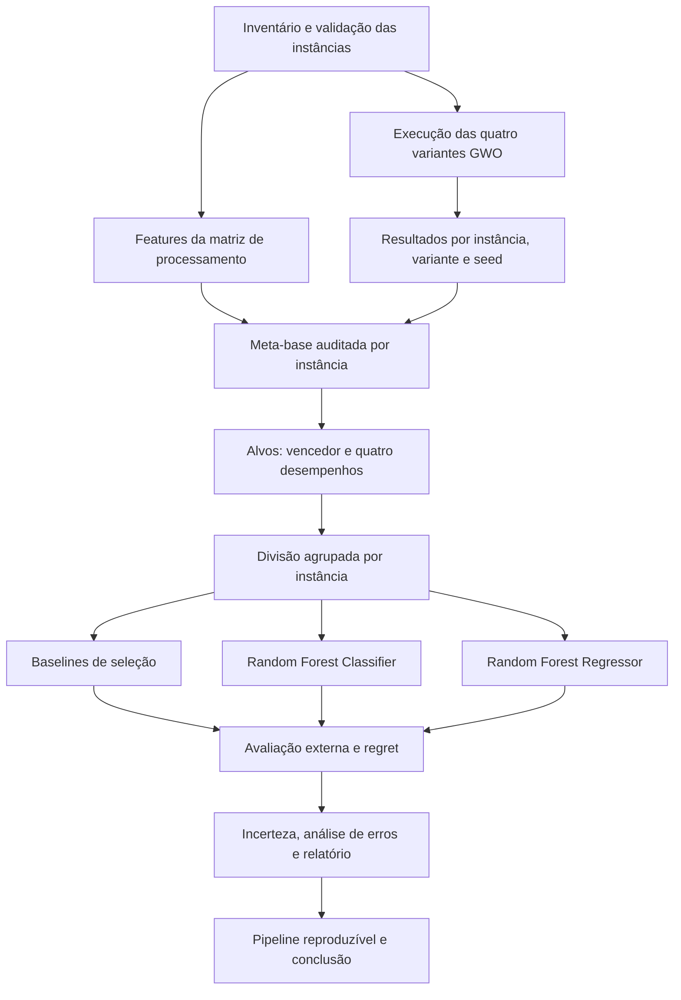

# Roadmap de planejamento e execução até a conclusão do Meta-Learning

**Data:** 27/11/2026  
**Branch de referência:** `recovery/surrogate-learning-curve-v2-oom`  
**Status:** Fases 1–4 concluídas; `metabasis_pilot_v1` congelada; LOO exploratório concluído sem ganho operacional útil vs sempre Fuzzy. Fase 5 ainda bloqueada por gate de reprodução/decisão.  
**Escopo:** selecionar automaticamente uma variante GWO para uma nova instância PFSP/Taillard, usando características da instância e resultados históricos das variantes.  
**Status detalhado:** [2026-11-27-meta-learning-phase-status.md](../reports/2026-11-27-meta-learning-phase-status.md).  
**LOO exploratório:** [2026-11-27-meta-learning-selector-loo-exploratory.md](../reports/2026-11-27-meta-learning-selector-loo-exploratory.md).  
**Próxima execução:** [runbook de reprodução e decisão](../reports/2026-11-27-meta-learning-next-execution-runbook.md).  
**Freeze:** [2026-11-27-metabasis-pilot-v1-freeze.md](../decisions/2026-11-27-metabasis-pilot-v1-freeze.md).

> Este documento é um plano de execução futuro. Não afirma que as etapas pendentes, a meta-base, os modelos ou a avaliação final já existam.

## 1. Objetivo final e fronteiras do trabalho

Dada uma instância PFSP/Taillard não vista durante o treinamento, o meta-modelo deverá recomendar uma das quatro variantes já existentes no projeto:

- `baseline`;
- `optuna`;
- `fuzzy`;
- `surrogate`.

O Meta-Learning aprende **qual variante GWO escolher para uma instância**. Ele não substitui o GWO, não prevê diretamente permutações, não aprende parâmetros internos do GWO nesta primeira versão e não é o mesmo problema que treinar um surrogate para prever makespan de uma permutação.

A entrega principal da disciplina continua sendo o estudo das variantes GWO e seus resultados no PFSP/Taillard. O Meta-Learning é uma extensão sobre essa base experimental; não deve desviar o projeto para um problema independente.

### 1.1 Dois trilhos relacionados, mas distintos

| Trilho | Pergunta | Papel no roadmap |
|---|---|---|
| Surrogate do GWO | Como estimar o makespan de candidatos visitados pelo GWO com erro e custo aceitáveis? | Melhorar/diagnosticar a variante GWO Surrogate; não constitui, por si só, Meta-Learning. |
| Meta-Learning | Dadas as características de uma instância, qual das quatro variantes GWO tende a produzir melhor resultado? | Objetivo final deste plano. |

A investigação da distribuição real de candidatos pode orientar representação, treinamento e avaliação do surrogate. Seus milhares de candidatos de uma mesma trajetória **não são milhares de instâncias independentes** e não podem inflar artificialmente o tamanho da meta-base.

## 2. Estado atual confirmado

### 2.1 Base experimental e infraestrutura

- Semanas 2–6 do projeto GWO foram executadas e auditadas; a Semana 6 compara Baseline, Optuna, Surrogate e Fuzzy em `ta001` e `ta011`, com 30 seeds por instância.
- O orçamento da variante Surrogate da Semana 6 é diferente: 1.530 avaliações exatas e 15.000 previsões por execução, contra 15.030 avaliações exatas nas outras variantes. Essa diferença deve permanecer explícita.
- Há um extrator inicial de características em `scripts/extract_instance_features.py`, com testes existentes. Ainda precisa passar por validação sistemática e ter sua versão congelada para a meta-base.
- O conjunto Taillard versionado contém 12 instâncias, uma por grupo de dimensão. É adequado para validar infraestrutura e custo, mas insuficiente para alegar generalização de Meta-Learning.
- O README de `experiments/meta_learning/` já propõe uma expansão progressiva: 36 instâncias, depois 60 e, se viável, o benchmark completo de 120 instâncias.
- As curvas de aprendizagem e comparação de modelos surrogate já foram estudadas. Elas dizem respeito ao surrogate de makespan, não ao seletor meta de variantes.

### 2.2 Investigação da distribuição de candidatos GWO

O piloto de auditoria em `ta111` foi executado com quatro variantes e seeds 0–4: 20 execuções, 300.600 candidatos rotulados com makespan exato. Os resumos e metadados estão versionados; o arquivo completo `populations.csv` (~551,40 MB) ficou fora do GitHub por exceder o limite de arquivo.

O piloto usou o modelo Cost Pilot v2 para `ta111`, pois o artefato original Week 4 para essa instância não estava disponível no caminho esperado. Portanto, não é reprodução exata do modelo Surrogate da Semana 6. Essa proveniência deve ser mantida em qualquer uso posterior.

**Pendências imediatas:** disponibilizar o CSV bruto por armazenamento externo; validar sua integridade; revisar o consumo de memória/deduplicação do runner; analisar as distribuições antes de ampliar a coleta. Não iniciar 30 seeds adicionais antes desses gates.

Relatórios de referência:
- [Piloto de distribuição dos candidatos GWO](../reports/2026-11-26-gwo-population-distribution-pilot.md).
- [Protocolo da auditoria de distribuição](../reports/gwo_population_distribution_audit_protocol.md).
- [Auditoria de falhas do surrogate](../../experiments/meta_learning/reports/surrogate_failure_analysis_2026-11-26.md).
- [Protocolo de comparação de modelos surrogate](../../experiments/meta_learning/reports/surrogate_model_comparison_protocol.md).
- [Plano metodológico atual de Meta-Learning](../../experiments/meta_learning/README.md).

### 2.3 Artefatos já existentes

- `experiments/meta_learning/data/instance_features.csv`: extração inicial versionada; validar conteúdo, cobertura e proveniência antes de tratá-la como feature set congelado.
- `experiments/meta_learning/scripts/extract_instance_features.py`: extrator inicial.
- `experiments/meta_learning/referencias.md`: referências sobre surrogate, seleção e otimização.
- `experiments/meta_learning/README.md`: definição metodológica prévia de classificação/regressão.
- Resultados da Semana 6 e artefatos de surrogate: fontes potenciais da meta-base, condicionadas à auditoria de compatibilidade.

## 3. Decisões metodológicas que ficam congeladas neste plano

1. **Unidade independente:** instância PFSP, não candidato, geração, execução ou seed.
2. **Preditores:** calculados exclusivamente da matriz de tempos de processamento. Não usar makespan, UB/LB, resultado de GWO, seed, nome/caminho ou identificador como feature.
3. **Alvo primário:** qualidade média por variante, normalizada por upper bound publicado e validado quando disponível. Casos sem UB exigem regra alternativa pré-definida e identificação explícita; não misturar escalas silenciosamente.
4. **Duas formulações sobre a mesma meta-base:**
   - classificação: variante com melhor desempenho médio normalizado;
   - regressão: quatro desempenhos médios normalizados; selecionar o menor valor previsto.
5. **Modelos iniciais:** RandomForestClassifier e RandomForestRegressor multioutput (ou quatro regressors, se o teste técnico justificar). RF é baseline inicial, não vencedor presumido.
6. **Comparação obrigatória:** seleção aleatória, cada variante fixa, melhor variante global aprendida apenas no treino, classificador e regressor.
7. **Divisão:** sempre por instância. Nenhuma instância pode aparecer em treino e teste, ainda que com seeds diferentes.
8. **Incerteza:** preservar resultados por seed; estimar incerteza de desempenho e instabilidade do rótulo vencedor.
9. **Orçamento:** não declarar igualdade de custo entre variantes. Reportar avaliações exatas, previsões, runtime, custo de preparação e custo da inferência meta separadamente.
10. **Reprodutibilidade:** congelar configuração, seeds, hashes, versão do extrator, commit, ambiente e protocolo antes da bateria confirmatória.

## 4. Pipeline de ponta a ponta

O trilho de auditoria da distribuição GWO antecede a decisão sobre o surrogate, mas não substitui a coleta multi-instância exigida pela meta-base.

## 5. Fases, tarefas e critérios de aceite

### Fase 0 — Congelar escopo, contratos e proveniência

**Objetivo:** impedir mistura entre experimentos de surrogate, resultados históricos e Meta-Learning.

- [ ] Revisar este roadmap e o README de Meta-Learning; registrar divergências e decisões finais.
- [ ] Inventariar os 12 arquivos Taillard disponíveis, dimensões, SHA-256, upper/lower bounds e proveniência.
- [ ] Inventariar resultados Week 6 e identificar quais combinações instância × variante × seed podem ser reutilizadas sem reexecução.
- [ ] Definir schema versionado para resultados por execução, features e meta-base; incluir origem histórica/novo experimento.
- [ ] Definir configuração congelada das quatro variantes e política de seeds.

**Aceite:** manifesto das instâncias e matriz de cobertura dos resultados existentes; nenhuma linha duplicada ou sem proveniência; protocolo e schema revisados.

**Verificação:** script de auditoria de hashes/completude; testes do schema; revisão manual de uma amostra de resultados históricos.

**Dependências:** nenhuma.

### Fase 1 — Recuperar e validar os dados da distribuição GWO

**Objetivo:** fechar a auditoria do piloto antes de aumentar o volume.

- [x] Preservar o `populations.csv` local; registrar tamanho e SHA-256 (`ca6212d2…`; 551,69 MB). Armazenamento externo ainda pendente.
- [x] Validar número de linhas, chaves, variantes, seeds, gerações, lobos por geração e correspondência com `runs.csv`.
- [x] Recalcular independentemente permutações e makespan de uma amostra estratificada (80/80 OK).
- [x] Confirmar que callbacks e rótulos diagnósticos não alteram resultados dos algoritmos (testes do observador).
- [x] Revisar deduplicação/checkpoint do runner para processamento em streaming ou memória limitada.
- [x] Produzir análise descritiva por geração e execução (entropia/unique/makespan; Kendall full pulado por custo).
- [x] Decidir expansão 0–29 da auditoria de população: **não** agora; foco na meta-base 36 instâncias.

**Aceite:** bruto íntegro e recuperável; análise reproduzível; limitações da amostra explícitas; decisão documentada sobre expansão.

**Verificação:** relatório de integridade, testes do leitor streaming e script de análise regenerando tabelas a partir do CSV bruto.

**Dependências:** Fase 0 e acesso ao CSV bruto.

**Gate:** não avançar para coleta ampliada de populações se o bruto não passar na auditoria.

### Fase 2 — Decidir e estabilizar o surrogate usado pela variante GWO

**Objetivo:** garantir que os resultados usados na meta-base correspondam a uma definição comparável da variante Surrogate.

- [x] Separar conclusões de qualidade global do surrogate de sua utilidade para ranking/seleção top-k.
- [x] Usar a distribuição real de candidatos para comparar erro, Spearman, recall top-k e regret (por geração/seed).
- [x] Comparar candidatos a modelos apenas em protocolo de desenvolvimento (piloto uniforme + ranking GWO); sem holdout confirmatório para escolha.
- [x] Definir modelo e artefatos Surrogate congelados (`docs/decisions/2026-11-27-surrogate-variant-freeze.md`).
- [x] Revalidar que a variante continua usando fitness exato para atualizar líderes (`tests/test_week6_surrogate.py`).
- [x] Surrogate fraco em ranking: manter variante histórica MLP Week 4; não retunar silenciosamente.

**Aceite:** especificação única e reproduzível da variante Surrogate para novos experimentos; protocolo de custo explícito; decisão registrada sobre manter ou alterar a implementação.

**Verificação:** testes do solver, auditoria de hashes, avaliação externa por execução e relatório de ranking/top-k.

**Dependências:** Fase 1 para análise da distribuição; relatórios de comparação de modelos.

**Gate:** nenhuma troca de modelo durante a construção da meta-base confirmatória.

### Fase 3 — Validar e congelar o extrator de características

**Objetivo:** transformar a extração inicial em um contrato estável e sem vazamento.

- [x] Auditar extrator e `instance_features.csv` contra as 36 instâncias disponíveis.
- [x] Testar invariância a caminho/nome, determinismo e dados inválidos.
- [x] Confirmar que todas as features usam somente a matriz de processamento.
- [x] Manter conjunto v1 interpretável e pré-especificado (35 preditores); revisão de redundância adiada a ablação pós-piloto.
- [x] Versionar schema (`taillard_pfsp_features_v1`); ver decisão de freeze.
- [x] Registrar que normalização/seleção aprendida só ocorre dentro dos folds (contrato; implementação no treino meta).

**Aceite:** extrator determinístico, testado, documentado e versionado; dataset de features reproduzível a partir das instâncias e hashes.

**Verificação:** suíte específica de features, comparação independente de amostras e teste de invariância ao renomear/mover arquivos.

**Dependências:** Fase 0.

### Fase 4 — Piloto multi-instância e estimativa de custo

**Objetivo:** medir a viabilidade da meta-base antes de comprometer uma bateria grande.

- [x] Expandir o conjunto de 12 para 36 instâncias (3 por grupo; espelho PISCO).
- [x] Garantir diversidade de jobs/máquinas via estratificação pelos 12 grupos Taillard.
- [x] Executar as quatro variantes em 3 seeds pareadas por instância (`meta_learning_metabasis_pilot_v1`, 432/432).
- [x] Medir runtime e custo por grupo (`meta_learning_cost_pilot_v3` + runs do piloto).
- [x] Estimar custo para expansão (≈1,06 h com 3 seeds; ≈3,54 h com 10 seeds no hardware local).
- [x] Auditar/agregar a meta-base piloto (`analyze_meta_learning_metabasis_pilot.py`; Fuzzy 17/36 wins; 22 rótulos de baixa margem).

**Aceite:** piloto de 36 instâncias concluído ou justificativa documentada de inviabilidade; estimativa de custo baseada em medições; decisão explícita de avançar, ajustar ou interromper.

**Verificação:** relatório de custo, relatório de cobertura, testes de integridade e reprodução de uma instância/seed.

**Dependências:** Fases 0, 2 e 3.

**Gate:** 36 instâncias são piloto de viabilidade, não evidência final de generalização. Não treinar um modelo final nem alegar desempenho generalizável nesta fase.

### Fase 5 — Decidir expansão e construir meta-base confirmatória

**Objetivo:** somente se a extensão for mantida após a reprodução do piloto, obter instâncias independentes suficientes para treinar e avaliar seleção de variantes.

**Gate de entrada (ainda pendente):** reproduzir hashes do freeze e LOO em diretório separado conforme o runbook; revisar divergências; registrar uma decisão aprovada sobre continuidade. O resultado atual não demonstra ganho de RF sobre sempre Fuzzy. Não iniciar execução GWO até este gate ser aprovado.

- [ ] Após decisão de continuidade, expandir prioritariamente a diversidade de 36 para 60 instâncias e planejar cobertura do benchmark de 120; não aumentar apenas seeds como substituto de novas instâncias.
- [ ] Reservar holdout por instância antes de tuning/seleção final; definir seu tamanho e estratificação por dimensão no plano da expansão.
- [ ] Priorizar 120 instâncias como objetivo de cobertura; se recursos impedirem, justificar quantitativamente o conjunto final e restringir as conclusões.
- [ ] Aumentar o número de seeds por instância conforme custo: começar com 10 e considerar 20–30 na fase confirmatória, preservando pareamento entre variantes.
- [ ] Executar configurações GWO congeladas; persistir checkpoints, logs e resultados por execução.
- [ ] Reutilizar Week 6 `ta001` e `ta011` somente quando hash, versão do algoritmo, configuração e definição de métricas forem compatíveis; registrar sua origem histórica.
- [ ] Não misturar resultados da auditoria de população, cost pilot ou curva de aprendizagem do surrogate com resultados de execução GWO sem equivalência de protocolo.
- [ ] Validar todas as combinações esperadas, duplicatas, falhas e contadores antes de agregar.

**Aceite:** meta-base bruta congelada, versionada por schema e com cobertura documentada; cada resultado rastreável a instância, variante, seed, commit, configuração e ambiente.

**Verificação:** auditoria automatizada de completude e hashes; reexecução independente de amostra; relatório de falhas e exclusões.

**Dependências:** Fase 4 aprovada.

**Gate:** esta fase só começa após decisão explícita. Congelar os dados antes de abrir o holdout ou ajustar modelos finais. Correções posteriores geram nova versão da meta-base; `metabasis_pilot_v1` permanece imutável.

### Fase 6 — Construir os alvos e controlar incerteza

**Objetivo:** converter resultados por seed em um problema de seleção por instância.

- [x] Agregar makespan por instância/variante com média, desvio-padrão; bootstrap do regret na avaliação LOO exploratória.
- [x] Normalizar o alvo por UB validado quando disponível; fallback `rel_best` documentado (neste piloto: UB 36/36).
- [x] Gerar quatro alvos contínuos por instância e o rótulo da variante com menor desempenho médio normalizado.
- [x] Calcular margem entre primeira e segunda variantes; sinalizar low-confidence (22/36) sem remoção silenciosa.
- [x] Preservar resultados por seed em `runs.csv` do freeze; sensibilidade via margem/low-confidence no relatório.
- [ ] Verificar correlação entre características e alvos apenas no conjunto de desenvolvimento, sem usar essa análise para selecionar features com acesso ao teste.

**Aceite:** uma linha por instância na meta-base derivada; quatro alvos e classe reproduzíveis; incerteza e regra de normalização documentadas.

**Verificação:** teste de reconstrução dos alvos a partir dos resultados brutos e validação manual de instâncias amostradas.

**Dependências:** Fase 5.

### Fase 7 — Treinar baselines, classificador e regressor

**Objetivo:** implementar e avaliar as estratégias de Meta-Learning sobre os mesmos folds. A implementação piloto já existe; a fase confirmatória (tuning, calibração e congelamento final) permanece pendente.

- [x] Implementar seletores baselines: aleatório uniforme, cada variante fixa e melhor variante global do treino (`evaluate_meta_learning_selectors_pilot.py`).
- [x] Implementar RandomForestClassifier para prever a variante vencedora (piloto LOO exploratório).
- [x] Implementar RandomForestRegressor multioutput (piloto LOO exploratório).
- [x] Fit apenas no treino de cada fold LOO; sem uso do holdout confirmatório (ainda inexistente).
- [ ] Ajustar hiperparâmetros apenas nos folds de desenvolvimento; manter orçamento de busca modesto e registrado.
- [x] Salvar previsões out-of-fold e summary (`selector_eval_exploratory_v1/`).
- [x] Comparar classificação e regressão na mesma divisão de instâncias (LOO).

**Aceite:** modelos reproduzíveis e baselines corretos; previsões out-of-fold disponíveis; nenhuma informação do holdout participa de treinamento ou tuning.

**Verificação:** testes de pipeline, auditoria de índices/grupos dos folds, reexecução determinística e relatório de vazamento.

**Dependências:** Fases 5 e 6.

### Fase 8 — Avaliação externa e análise estatística

**Objetivo:** medir se a seleção meta melhora a decisão em instâncias não vistas. O LOO atual é apenas exploratório: 36 instâncias, 35 preditores, folds fortemente sobrepostos e sem holdout reservado.

- [ ] Reservar holdout de instâncias antes do tuning final, estratificando por grupos de dimensão quando possível.
- [x] No piloto: Leave-One-Instance-Out agrupado; resultado declarado **exploratório** (n=36, 22 rótulos low-margin).
- [ ] Como análise secundária, testar generalização para grupos/famílias de dimensão não vistos, quando a quantidade de instâncias permitir.
- [x] Classificação piloto: accuracy LOO reportada (complementar); balanced/macro-F1/calibração ainda pendentes.
- [x] Regressão piloto: regret da variante selecionada (primário); MAE/RMSE por variante ainda pendentes.
- [x] Decisão piloto: regret + IC bootstrap + pareado vs sempre Fuzzy — RF não supera Fuzzy de forma útil.
- [x] Reportar low-confidence (22/36) e ausência de ganho vs Fuzzy no status 2026-11-27.
- [ ] Reportar custo de inferência meta e custo da variante escolhida; manter custo de treino/benchmark separado.
- [x] Sem holdout confirmatório nesta rodada; avaliação LOO explícita como exploratória.

**Aceite:** comparação justa com baselines em instâncias não vistas; métricas, incerteza, regret, falhas e limites reportados.

**Verificação:** script único de avaliação, dados de previsão out-of-fold/holdout, testes de ausência de sobreposição entre grupos e relatório reproduzível.

**Dependências:** Fase 7.

### Fase 9 — Empacotar, documentar e concluir

**Objetivo:** deixar o Meta-Learning reproduzível e integrado ao projeto GWO.

- [ ] Criar comando único para extrair features, construir/validar meta-base, treinar e avaliar; permitir executar etapas isoladamente.
- [ ] Implementar retomada segura e outputs versionados; nunca sobrescrever datasets ou modelos anteriores.
- [ ] Documentar como recomendar uma variante para uma instância nova e quais entradas são necessárias.
- [ ] Criar relatório final com protocolo, proveniência, resultados, incerteza, ablações, custos, limitações e ameaças à validade.
- [ ] Atualizar README de Meta-Learning e referências bibliográficas apenas com fontes efetivamente utilizadas.
- [ ] Executar testes completos e CI; revisar scripts, artefatos e documentação.
- [ ] Preparar apresentação separando resultados obrigatórios do projeto GWO e extensão opcional de Meta-Learning.
- [ ] Publicar commits pequenos e rastreáveis; manter datasets grandes fora do Git quando excederem limites, com hash e instruções de obtenção.

**Aceite final:** um comando reproduz as etapas a partir dos dados versionados/arquivados; modelos e avaliação externa são reproduzíveis; conclusão responde se há evidência de que Meta-Learning seleciona variantes melhor que baselines simples, ou declara honestamente que a evidência é insuficiente.

**Dependências:** Fases 0–8.

## 6. Checkpoints de decisão

| Checkpoint | Momento | Decisão exigida |
|---|---|---|
| C0 | Após inventário | Protocolo, fontes e schema estão inequívocos? |
| C1 | Após auditoria do CSV | Dados brutos íntegros e análise de distribuição reproduzível? |
| C2 | Após análise do surrogate | Variante Surrogate está congelada e comparável? |
| C3 | Após features | Extrator determinístico, sem vazamento e versionado? |
| C4 | Após 36 instâncias | Custo e cobertura justificam expansão? |
| C5 | Após 60 instâncias | Expandir para 120 ou justificar conjunto final menor? |
| C6 | Antes do treinamento | Meta-base completa e congelada; holdout reservado? |
| C7 | Após validação agrupada | Meta-modelos superam baselines de forma estável? |
| C8 | Conclusão | Evidência suficiente, limitações e reprodução documentadas? |

Nenhum checkpoint deve ser aprovado apenas porque um script terminou sem erro. Cada decisão exige artefatos de auditoria e critérios de aceite.

## 7. Riscos e mitigação

| Risco | Impacto | Mitigação |
|---|---|---|
| Tratar candidatos de uma trajetória como instâncias independentes | Vazamento e falsa amostra grande | Unidade estatística sempre é a instância; seeds/candidatos ficam agrupados |
| Meta-base pequena ou pouco diversa | Generalização não demonstrada | Expansão 36 → 60 → 120, com cobertura por dimensão |
| Custo da bateria inviável | Execução incompleta ou sem repetição | Piloto medido, checkpoints, estimativa e expansão condicionada |
| Surrogate muda entre instâncias/versões | Alvo contaminado por protocolos diferentes | Congelar modelo/protocolo e registrar hashes; separar dados incompatíveis |
| Feature usa informação do resultado | Vazamento direto | Features somente da matriz de processamento; testes de contrato |
| UB ausente ou inconsistente | Normalização não comparável | Regra alternativa pré-registrada e reportada separadamente |
| Rótulo vencedor instável | Classificação enganosa | Intervalos, margem, sensibilidade e regret |
| Tuning consulta holdout | Otimismo na avaliação | Holdout fechado; tuning apenas no desenvolvimento |
| Diferença de custo entre variantes omitida | Recomendação operacional enganosa | Reportar avaliações, inferência, treino e runtime separadamente |
| Dataset grande no Git | Push rejeitado e histórico pesado | Armazenamento externo, hash, manifesto e instruções de recuperação |

## 8. Critérios globais de conclusão do Meta-Learning

O trabalho só será considerado concluído quando todos os itens abaixo forem verdadeiros:

- [ ] Conjunto de instâncias independente e diverso, com tamanho final justificado e proveniência verificável.
- [ ] Features determinísticas, versionadas e calculadas sem resultados de otimização.
- [ ] Resultados das quatro variantes completos, auditáveis e sob protocolo congelado.
- [ ] Meta-base por instância construída a partir de resultados por seed, com alvos e incerteza documentados.
- [ ] Treino, validação e teste separados exclusivamente por instância.
- [ ] Baselines simples implementados sem consultar rótulos do teste.
- [ ] Classificação e regressão avaliadas sobre as mesmas divisões.
- [ ] Métricas de classificação/regressão, regret, custo e intervalos de incerteza publicados.
- [ ] Análise de erros, rótulos instáveis e limites de generalização documentados.
- [ ] Pipeline de reprodução, testes e CI aprovados.
- [ ] README, relatório final e apresentação distinguem claramente Meta-Learning da otimização GWO e do surrogate de makespan.

Se o modelo não superar os baselines, isso não invalida o experimento: a conclusão correta será que, sob a meta-base e protocolo avaliados, não houve evidência suficiente de benefício. Não ajustar o protocolo retroativamente para forçar resultado positivo.

## 9. Ordem prática recomendada para a próxima sessão

1. Executar o runbook vigente: confirmar branch/HEAD, rodar testes, verificar os quatro hashes do freeze e reproduzir o LOO em diretório novo.
2. Comparar os artefatos reproduzidos com o relatório LOO e investigar qualquer divergência sem sobrescrever o freeze.
3. Registrar decisão: (a) expandir instâncias com novo freeze e holdout pré-reservado; (b) encerrar a extensão como resultado exploratório sem ganho demonstrado; ou (c) reformular a pergunta com novo protocolo.
4. Se (a), priorizar 60–120 instâncias independentes; mais seeds refinam estimativas dentro de instâncias, mas não corrigem n pequeno.
5. Não retunar Surrogate, RF ou features consultando holdout; não iniciar bateria GWO sem decisão registrada.

**Gate atual:** apenas reprodução e decisão. A expansão 60/120 não está autorizada.

## 10. Relação com outros planos e manutenção

- `tasks/plan.md` e `tasks/todo.md` são planos gerais anteriores do repositório e permanecem preservados.
- `tasks/week6_plan.md` registra a conclusão da Semana 6 e suas pendências de apresentação.
- `experiments/meta_learning/README.md` continua sendo a referência metodológica do Meta-Learning; este roadmap operacionaliza sua execução em fases e gates.
- Atualizar este documento ao concluir cada fase, preservando histórico de decisões. Não marcar tarefas concluídas sem artefato verificável.
