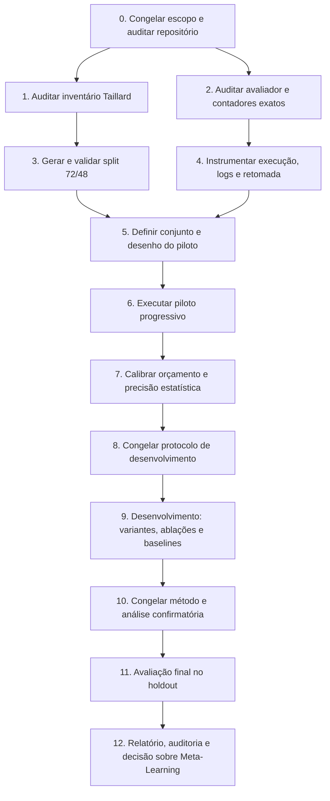

# Pipeline To-Do — preparação da próxima bateria GWO/PFSP

**Data:** 2026-11-27  
**Status:** backlog de execução; nenhuma tarefa abaixo é considerada concluída apenas por estar documentada  
**Escopo:** PFSP clássico, minimização de makespan, GWO como objeto central  
**Documentos-base:** [roteiro experimental](gwo_pfsp_experimental_roadmap_2026-11-27.md), [registro de decisões](../decisions/2026-11-27-gwo-pfsp-research-roadmap.md), [revisão de literatura](gwo_pfsp_literature_review_2026-11-27.md).

Este arquivo transforma as decisões metodológicas em uma sequência operacional com dependências, entregáveis e critérios de aceite. Marque uma tarefa como concluída somente quando o artefato/evidência indicado existir e tiver sido revisado.

## Visão geral e ordem de execução

**Regra de dependência:** não iniciar uma fase se seus pré-requisitos não passaram pelos critérios de aceite. É permitido executar em paralelo somente as tarefas explicitamente independentes (principalmente auditoria do inventário e do avaliador).

---

## Fase 0 — alinhamento e auditoria do estado atual

### 0.1 Confirmar o ponto de partida
- [ ] Registrar branch, HEAD, data, working tree e versão do ambiente.
- [ ] Identificar os commits/documentos que definem o protocolo antigo e o novo.
- [ ] Listar os scripts, notebooks, configurações e workflows ainda usados.
- [ ] Separar resultados históricos por protocolo; não misturar números de baterias diferentes.
- [ ] Confirmar que o escopo ativo é PFSP clássico/makespan e marcar implementações de DPFSP, tardiness ou outras variantes como fora da comparação principal.

**Entregável:** relatório versionado do estado atual do repositório.  
**Aceite:** qualquer pessoa consegue identificar qual código/configuração reproduz cada resultado histórico e qual será a base da nova bateria.

### 0.2 Auditoria de integridade dos métodos
- [ ] Executar a suíte de testes existente e registrar comando, ambiente e resultado.
- [ ] Verificar implementação do GWO: atualização síncrona, posições efetivamente atualizadas, líderes e limites conforme regra documentada.
- [ ] Verificar que Baseline, Optuna, Fuzzy e Surrogate chamam o mesmo avaliador exato de makespan.
- [ ] Confirmar que nenhuma estratégia usa makespan predito como valor final de fitness sem reavaliação exata.
- [ ] Revisar tratamento de falhas, NaN/Inf, soluções inválidas e interrupções.

**Entregável:** relatório de auditoria de código/testes com problemas, correções e evidências.  
**Aceite:** testes passam; diferenças de comportamento e limitações conhecidas estão registradas; nenhum bug bloqueante no caminho crítico.

## Fase 1 — inventário e split Taillard

### 1.1 Construir inventário canônico
- [ ] Localizar todos os arquivos Taillard usados pelo projeto e fontes de download/proveniência.
- [ ] Confirmar a presença das 120 instâncias esperadas e as 12 classes dimensionais.
- [ ] Validar parser: jobs, máquinas, matriz de processamento e convenções de indexação.
- [ ] Validar dimensões e valores (tempos positivos/inteiros conforme formato).
- [ ] Calcular SHA-256 por arquivo e registrar caminho relativo, tamanho, dimensão e hash.
- [ ] Detectar duplicatas, arquivos ausentes, inconsistências e nomes ambíguos.
- [ ] Conferir amostras manualmente contra a fonte de referência.

**Entregável:** inventário versionado (CSV/JSON) e script reproduzível de validação.  
**Aceite:** 120/120 instâncias identificadas e válidas, ou discrepâncias justificadas e resolvidas antes da seleção.

### 1.2 Gerar divisão estratificada 72/48
- [ ] Fixar e registrar uma seed exclusiva para a seleção.
- [ ] Usar amostragem aleatória reprodutível dentro de cada uma das 12 classes.
- [ ] Selecionar 6 instâncias/classe para desenvolvimento e reservar 4/classe para holdout.
- [ ] Verificar ausência de sobreposição, cobertura de todas as classes e contagens exatas.
- [ ] Persistir IDs, classe, dimensão, split, seed e hashes dos arquivos.
- [ ] Gerar relatório de auditoria do split.
- [ ] Restringir operacionalmente o holdout para que scripts de tuning/seleção não o consumam.

**Entregáveis:** arquivo de split 72/48, script de geração e relatório.  
**Aceite:** 72 + 48 = 120, 6 + 4 por classe, zero sobreposição, split reproduzível e holdout reservado.  
**Atenção:** não inventar nem escolher IDs manualmente com base em desempenho.

## Fase 2 — avaliador exato, orçamento e instrumentação

### 2.1 Auditar o avaliador de makespan
- [ ] Identificar uma única implementação de referência para o cálculo exato de Cmax.
- [ ] Criar testes unitários com instâncias pequenas calculadas manualmente ou por implementação independente.
- [ ] Verificar permutações válidas, jobs repetidos/ausentes e dimensões incompatíveis.
- [ ] Verificar equivalência com uma segunda implementação ou resultados de referência.
- [ ] Medir custo do avaliador por dimensão de instância.

**Entregável:** testes de referência e relatório de correção/custo.  
**Aceite:** cálculo correto demonstrado em casos conhecidos e entradas inválidas rejeitadas explicitamente.

### 2.2 Instrumentar avaliações exatas
- [ ] Criar contador centralizado, incrementado exclusivamente quando o avaliador exato é chamado.
- [ ] Definir o que entra na conta: população inicial, candidatos, busca local, NEH/IG, reavaliações e dados de treinamento rotulados pelo avaliador.
- [ ] Separar contadores: avaliações exatas de busca, preparação/treino, validação/reavaliação e previsões do surrogate.
- [ ] Se houver cache, registrar chamadas solicitadas e cache hits separadamente; definir se o limite usa chamadas ou cálculos efetivos e reportar ambos.
- [ ] Adicionar testes que confirmem contagem em cada estratégia e em caminhos de falha.
- [ ] Implementar limite de orçamento por avaliação exata, inclusive quando uma geração/lote excederia o teto.
- [ ] Salvar best-so-far e curva de convergência indexada por avaliação exata.

**Entregável:** instrumentação compartilhada, testes e esquema de resultados.  
**Aceite:** contadores auditáveis, sem subcontagem ou dupla contagem; algoritmo não ultrapassa silenciosamente o limite.

### 2.3 Definir ladder de orçamento
- [ ] Medir custo de execução em piloto técnico curto, por classe e algoritmo.
- [ ] Definir orçamento-base absoluto B0, sem escolhê-lo apenas por conveniência.
- [ ] Calcular checkpoints B0 × {1, 2, 3, 5, 8}; avaliar 13 somente se custo e evidência justificarem.
- [ ] Documentar arredondamento para lotes/populações e orçamento efetivamente alcançado.
- [ ] Fixar limite de tempo/recursos e regra para execução interrompida.
- [ ] Definir como contabilizar treino do surrogate e custo de tuning do Optuna nas comparações.

**Entregável:** especificação versionada do orçamento por classe/método e script de validação.  
**Aceite:** orçamento absoluto e regra de contagem estão congelados antes da bateria de desenvolvimento.

## Fase 3 — execução reproduzível e observabilidade

### 3.1 Manifesto e configuração
- [ ] Definir esquema único de configuração para instância, algoritmo, parâmetros, orçamento, seed e versão do código.
- [ ] Derivar seeds de forma determinística e registrar RNG/gerador.
- [ ] Definir seeds aninhadas: expansões acrescentam novas seeds, sem substituir as anteriores.
- [ ] Registrar versões de Python, dependências, SO, hardware e commit.
- [ ] Registrar ordem de execução e política de aleatorização/intercalação de métodos.

### 3.2 Logs, retomada e integridade
- [ ] Salvar resultado individual por instância × algoritmo × orçamento × seed.
- [ ] Salvar status, exceções, duração, contadores, parâmetros e artefatos auxiliares.
- [ ] Implementar retomada idempotente: não duplicar runs concluídos e permitir recuperar runs incompletos.
- [ ] Criar verificador de completude que compare matriz esperada × resultados existentes.
- [ ] Criar hashes/manifesto dos arquivos de entrada e resultados.
- [ ] Testar interrupção forçada e retomada em pequena escala.
- [ ] Definir política de escrita atômica e prevenção de corrupção.

**Entregável:** runner, schema, verificador de completude e teste de recuperação.  
**Aceite:** execução pequena interrompida e retomada produz a mesma matriz lógica que uma execução contínua, sem duplicatas.

## Fase 4 — piloto

### 4.1 Desenho do piloto
- [ ] Escolher subconjunto piloto cobrindo dimensões pequenas, médias e grandes; registrar regra antes de observar resultados.
- [ ] Incluir Baseline, Optuna, Fuzzy e Surrogate após auditoria de cada método.
- [ ] Incluir NEH como baseline construtivo assim que validado; decidir explicitamente se IG cabe no piloto técnico ou fica para desenvolvimento.
- [ ] Definir configuração inicial apenas para estimar custo e variabilidade.
- [ ] Executar progressão cumulativa de 10, depois 20, depois 30 seeds.
- [ ] Executar checkpoints de orçamento Fibonacci; não é obrigatório executar todos se critérios de parada forem atingidos.
- [ ] Verificar completude, retomada, contadores e consistência dos logs.

### 4.2 Análise do piloto
- [ ] Estimar média, mediana, desvio padrão e intervalos de confiança por instância/método/orçamento.
- [ ] Estimar variabilidade entre seeds e custo de parede por classe.
- [ ] Construir curvas de qualidade versus avaliações exatas e versus tempo.
- [ ] Verificar retornos marginais ao aumentar orçamento.
- [ ] Avaliar se 10/20/30 seeds são suficientes para estimar variabilidade no desenvolvimento.
- [ ] Identificar outliers, instâncias caras e métodos com overhead elevado.
- [ ] Não usar piloto para afirmar superioridade generalizável.

**Entregável:** relatório de piloto, dados brutos e scripts de análise.  
**Aceite:** custo previsto para 72 instâncias e execução final é conhecido; limitações e ajustes estão justificados.

## Fase 5 — congelar protocolo após piloto

- [ ] Fixar B0 e checkpoints permitidos por classe/método.
- [ ] Fixar teto de avaliações exatas e política de arredondamento.
- [ ] Fixar número inicial e progressão de seeds do desenvolvimento (20 → 30 → 40).
- [ ] Definir métrica primária e largura/precisão-alvo dos intervalos para a avaliação final.
- [ ] Definir bloco de expansão de seeds (proposta inicial +10) e teto máximo de seeds.
- [ ] Definir regra de parada baseada em precisão, nunca em significância ou direção favorável.
- [ ] Definir método de intervalo de confiança e unidade de reamostragem.
- [ ] Definir comparações primárias/secundárias, testes e correção de multiplicidade.
- [ ] Congelar lista de instâncias, algoritmos, parâmetros, ablações e baselines do desenvolvimento.
- [ ] Versionar protocolo e registrar commit antes da bateria.

**Entregável:** protocolo pré-registrado do desenvolvimento e plano de análise confirmatória.  
**Aceite:** nenhum parâmetro essencial do desenho permanece ambíguo; todas as decisões têm justificativa e versão.

## Fase 6 — desenvolvimento nas 72 instâncias

### 6.1 Comparação principal
- [ ] Executar Baseline, Optuna, Fuzzy e Surrogate sob orçamento exato comparável.
- [ ] Executar NEH e, após validação, IG.
- [ ] Começar com 20 seeds e ampliar para 30/40 segundo plano.
- [ ] Reportar separadamente custo de tuning, treino, inferência e avaliações exatas.
- [ ] Produzir curvas por avaliações exatas e tempo.
- [ ] Analisar resultados por classe e dimensão, além do agregado.

### 6.2 Validação e ablações
- [ ] GWO: medir diversidade também após decodificação; colisões/duplicatas de Random Keys; convergência e estagnação.
- [ ] GWO: sensibilidade a população, agenda de a, limites e orçamento.
- [ ] Optuna: separar dados/seeds/instâncias de tuning e avaliação; contabilizar custo dos trials.
- [ ] Fuzzy: controlador completo, sem diversidade, sem estagnação, sem ambas e controle fixo comparável.
- [ ] Surrogate: split agrupado por permutação decodificada; chaves que geram a mesma permutação no mesmo grupo.
- [ ] Surrogate: métricas de regressão e ranking (MAE, RMSE, R², Spearman, recall top-k); reavaliar solução final exatamente.
- [ ] Documentar mecanismo, hipótese, custo, evidência e resultado de cada ablação.

### 6.3 Seleção do método
- [ ] Aplicar plano estatístico predefinido, incluindo Friedman, Wilcoxon pareado e Holm quando apropriado.
- [ ] Reportar CIs, tamanhos de efeito, vitórias/empates/derrotas e heterogeneidade.
- [ ] Selecionar variante/configuração exclusivamente com dados de desenvolvimento.
- [ ] Documentar limitações, falhas e decisões negativas (mecanismos descartados e por quê).

**Entregável:** relatório de desenvolvimento e candidato(s) congelado(s).  
**Aceite:** método final, parâmetros, orçamento e scripts estão versionados; holdout não foi consultado para seleção.

## Fase 7 — congelamento pré-holdout

- [ ] Congelar commit do código e ambiente.
- [ ] Congelar parâmetros, seeds iniciais, política de expansão e orçamento.
- [ ] Congelar features, regras fuzzy, modelo surrogate e política de atualização.
- [ ] Congelar baselines, métricas, comparações e scripts estatísticos.
- [ ] Gerar manifesto reproduzível da avaliação final.
- [ ] Verificar que os 48 IDs do holdout não aparecem em tuning/seleção.
- [ ] Registrar data e commit do congelamento.

**Entregável:** manifesto de avaliação final e registro de congelamento.  
**Aceite:** qualquer mudança posterior é tratada como desvio protocolar e documentada.

## Fase 8 — avaliação final nas 48 instâncias

- [ ] Executar inicialmente 40 seeds por instância/configuração.
- [ ] Calcular intervalos de confiança e precisão para métricas primárias e diferenças pareadas.
- [ ] Se necessário, acrescentar blocos de seeds (inicialmente +10), respeitando teto e regra pré-registrada.
- [ ] Não interromper por p-value, significância ou resultado favorável.
- [ ] Não ajustar algoritmo, parâmetros, features ou regra após observar holdout.
- [ ] Registrar falhas e desvios sem substituir silenciosamente runs.
- [ ] Executar análise estatística congelada e análise por classe.

**Entregável:** resultados brutos completos, relatório confirmatório e scripts.  
**Aceite:** matriz esperada completa ou ausências justificadas; nenhuma decisão de tuning baseada no holdout.

## Fase 9 — relatório final e retomada de Meta-Learning

- [ ] Consolidar qualidade, custo, estabilidade e incerteza.
- [ ] Comparar com NEH/IG e literatura somente quando protocolos forem comparáveis.
- [ ] Discutir validade externa: Taillard cobre classes específicas; não generalizar além da evidência.
- [ ] Documentar limitações, ameaças à validade e trabalhos futuros.
- [ ] Auditar a meta-base: qualidade dos rótulos, cobertura de instâncias, features e proveniência.
- [ ] Se a base estiver pronta, reabrir planejamento de Meta-Learning com split agrupado por instância.
- [ ] Manter VRF como benchmark complementar futuro; não misturar seus resultados com Taillard sem análise própria.

**Entregável:** relatório geral auditado e decisão explícita sobre retomar Meta-Learning.  
**Aceite:** conclusões sustentadas pelos dados, limitações declaradas e resultados reproduzíveis.

---

## Gates de decisão

| Gate | Condição obrigatória para avançar |
|---|---|
| G0 → G1 | Código/testes e escopo auditados |
| G1 → G2 | Inventário Taillard validado |
| G2 → G3 | Split 72/48 reproduzível e holdout reservado |
| G3 → G4 | Avaliador e contadores exatos testados |
| G4 → G5 | Runner, logs e retomada validados |
| G5 → G6 | Piloto analisado; B0 e regra de precisão definidos |
| G6 → G7 | Desenvolvimento concluído e método selecionado |
| G7 → G8 | Código, método e análise congelados |
| G8 → G9 | Holdout analisado sem tuning; relatório auditado |

## Regras permanentes do projeto

1. **Não alterar o problema:** PFSP clássico/makespan permanece o alvo da comparação principal.
2. **Não confundir orçamento:** previsões surrogate não são avaliações exatas; custos de treino e tuning devem aparecer.
3. **Não vazar holdout:** as 48 instâncias não participam de seleção nem ajuste.
4. **Não confundir seeds com instâncias:** seeds estimam variabilidade estocástica; instâncias sustentam afirmações de generalização.
5. **Não apagar histórico:** resultados antigos permanecem associados ao protocolo que os produziu.
6. **Não declarar conclusão por notebook executado:** exige artefatos, testes, completude, auditoria e relatório.
7. **Não forçar Fibonacci:** checkpoints são níveis de orçamento candidatos; o piloto e o custo real determinam quais são viáveis.
8. **Não forçar 40 seeds como número mágico:** avaliação começa em 40 e expande apenas segundo regra de precisão definida antes do holdout.

## Próxima sessão de trabalho

Executar somente o início da Fase 0 e as tarefas independentes das Fases 1 e 2:

1. auditar branch/HEAD, scripts, notebooks e testes;
2. inventariar e validar os arquivos Taillard;
3. localizar o avaliador exato e mapear todos os pontos que o chamam;
4. projetar/testar o contador central de avaliações exatas.

**Não iniciar ainda** a seleção definitiva 72/48, o piloto completo ou a bateria de desenvolvimento até que inventário, avaliador e contadores tenham passado pelos respectivos gates.
