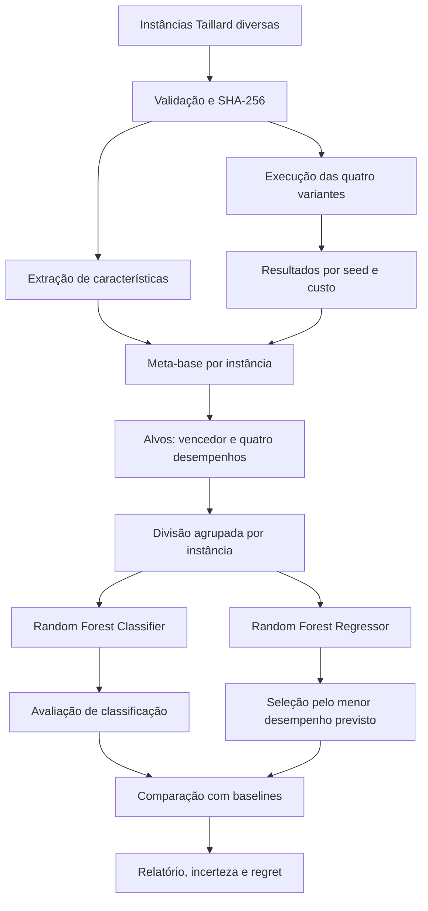

# Plano de Meta-Learning: classificação e regressão

**Status (2026-11-27):** piloto 36×3×4 congelado (`metabasis_pilot_v1`); LOO exploratório sem ganho operacional demonstrado vs sempre Fuzzy; reprodução A–D aprovada. **Expansão Fase 5 aprovada:** 60 instâncias primeiro, 120 como alvo condicionado a custo/integridade. A coleta v2 ainda não começou; inventário, split pré-registrado e adaptação técnica são gates obrigatórios. A curva/comparação de surrogate abaixo é trilho distinto.

Este documento define o pipeline metodológico e aponta o estado real dos artefatos. É uma extensão opcional do projeto, não etapa obrigatória do roteiro do professor e não substitui as Semanas 1–6.

### Estado do trilho Meta-Learning (seleção de variantes)

| Artefato | Caminho |
|---|---|
| Freeze da meta-base | [`data/metabasis_pilot_v1/`](data/metabasis_pilot_v1/) |
| Decisão de freeze | [`docs/decisions/2026-11-27-metabasis-pilot-v1-freeze.md`](../../docs/decisions/2026-11-27-metabasis-pilot-v1-freeze.md) |
| Status das fases | [`docs/reports/2026-11-27-meta-learning-phase-status.md`](../../docs/reports/2026-11-27-meta-learning-phase-status.md) |
| Relatório LOO exploratório | [`docs/reports/2026-11-27-meta-learning-selector-loo-exploratory.md`](../../docs/reports/2026-11-27-meta-learning-selector-loo-exploratory.md) |
| Reprodução A–D | [`docs/reports/2026-11-27-meta-learning-reproduction-ad.md`](../../docs/reports/2026-11-27-meta-learning-reproduction-ad.md) |
| Decisão de expansão v2 | [`docs/decisions/2026-11-27-meta-learning-expansion-v2.md`](../../docs/decisions/2026-11-27-meta-learning-expansion-v2.md) |
| Roadmap | [`docs/plans/2026-11-27-meta-learning-completion-roadmap.md`](../../docs/plans/2026-11-27-meta-learning-completion-roadmap.md) |
| Runbook | [`docs/reports/2026-11-27-meta-learning-next-execution-runbook.md`](../../docs/reports/2026-11-27-meta-learning-next-execution-runbook.md) |

### Resultado do piloto de seleção

| Seletor | Regret médio | Leitura |
|---|---:|---|
| Sempre Fuzzy | 0,0029187 | baseline operacional atual |
| RF regressor | 0,0029053 | diferença pontual mínima; 5/3/28 no pareado vs Fuzzy |
| RF classifier | 0,0052324 | pior que sempre Fuzzy |

O RF regressor não demonstrou superioridade: IC95 se sobrepõem amplamente e há 28 empates em 36 instâncias. O piloto tem 36 unidades independentes e 35 preditores; LOO não substitui holdout externo. Aumentar seeds não resolve a limitação do número de instâncias. Ver [relatório LOO](../../docs/reports/2026-11-27-meta-learning-selector-loo-exploratory.md).

**Próxima ação:** executar os gates do [runbook de expansão](../../docs/reports/2026-11-27-meta-learning-next-execution-runbook.md): inventário Taillard 120, split estratificado e imutável, adaptação/testes dos scripts v2. Não sobrescrever o freeze piloto.

Comandos usados na reprodução (já executados; não repetir sobre o freeze):

```bash
python -m pytest -q tests/test_meta_learning_features.py tests/test_meta_learning_metabasis_pilot.py tests/test_gwo_population_deduplicate.py tests/test_week6_surrogate.py
python -m scripts.evaluate_meta_learning_selectors_pilot --freeze-dir experiments/meta_learning/data/metabasis_pilot_v1 --output results/meta_learning_metabasis_pilot_v1/selector_eval_recheck_20261127 --seed 0 --random-repeats 100
```


### Expansão aprovada: metabasis_v2

A decisão formal autoriza uma expansão em dois estágios. O piloto de 36 instâncias permanece exclusivamente no desenvolvimento.

| Estágio | Desenvolvimento | Holdout selado | Total |
|---|---:|---:|---:|
| 60 | 48 (4 por grupo) | 12 (1 por grupo) | 60 |
| 120 | 96 (8 por grupo) | 24 (2 por grupo) | 120 |

Em cada grupo Taillard, as 7 instâncias ainda não usadas serão divididas deterministicamente em 5 para desenvolvimento e 2 para holdout, sem consultar resultados. Seed pré-registrada: 20261127, usando numpy.random.default_rng e grupos em ordem lexicográfica; registrar versão NumPy e hash do inventário. Se houver expansão a 120, os 12 holdouts do checkpoint de 60 continuam selados; o holdout final de 24 só será aberto uma vez, depois do congelamento do pipeline. Seeds iniciais: 0, 1 e 2 pareadas. Não aumentar seeds como substituto de instâncias independentes.

A inspeção dos scripts identificou defaults de piloto: o runner ainda registra protocolo v1 e o freezer grava schema metabasis_pilot_v1. Portanto, a bateria v2 não deve ser iniciada até a adaptação e os testes previstos no runbook. A coleta ainda não foi executada.

## Trabalho concluído relacionado: curva de aprendizagem do surrogate

Foi executada e analisada uma extensão separada para avaliar o efeito do tamanho do conjunto de treinamento do MLP surrogate da Semana 4. Os resultados cobrem `ta071` e `ta111`, LHS e amostragem uniforme, de 300 a 32.000 amostras, com cinco repetições por ponto e teste fixo por instância.

- [Análise estatística consolidada e IC95%](reports/surrogate_learning_curve_v2_extension_statistical_analysis.md).
- [Protocolo da próxima etapa: comparação de modelos](reports/surrogate_model_comparison_protocol.md).
- [Protocolo v2 de amostragem e diagnósticos](reports/surrogate_learning_curve_v2_protocol.md).
- [Relatório de recuperação da execução interrompida](reports/surrogate_learning_curve_v2_recovery.md).

Essa curva **não é a meta-base de Meta-Learning** descrita neste documento: ela estuda o surrogate de makespan, não aprende a escolher entre variantes GWO. O trilho de seleção de variantes tem piloto próprio (`metabasis_pilot_v1` + LOO exploratório); não misturar as duas conclusões.

## 1. Objetivo

Dada uma instância PFSP/Taillard ainda não vista, selecionar automaticamente uma das quatro estratégias GWO avaliadas na Semana 6:

- `baseline`;
- `optuna`;
- `surrogate`;
- `fuzzy`.

A camada meta aprende a escolher a estratégia. Ela **não** substitui o avaliador de makespan, não prevê diretamente permutações e não altera os algoritmos-base.

O escopo inicial é o PFSP clássico de uma fábrica, minimizando makespan. Não misturar com PFS/tardiness histórico, DPFSP-DD ou com a proposta original dengue/LSTM.

## 2. Decisão arquitetural: uma base, dois modelos

O pipeline terá duas fases separadas:

1. **Construção da meta-base:** extrair características de cada instância e obter os resultados das quatro variantes sob protocolo controlado.
2. **Treinamento e avaliação:** derivar alvos de classificação e regressão da mesma meta-base e treinar os dois modelos em paralelo.

Assim, cada instância é executada uma única vez por combinação variante × seed. Classificação e regressão não provocam uma segunda bateria GWO.

### 2.1 Classificação

Uma linha por instância. O alvo é a variante com menor desempenho médio normalizado, considerando as seeds daquela instância.

Modelo inicial: `RandomForestClassifier`.

Saídas:
- classe prevista;
- probabilidades por variante;
- confiança/margem entre as duas maiores probabilidades.

A classe-alvo será derivada dos resultados agregados por instância, nunca de uma execução individual. Registrar margem entre a melhor e a segunda melhor variante. Instâncias com diferenças muito pequenas serão sinalizadas como rótulos de baixa confiança para análise de sensibilidade; não ocultar empates ou instabilidade.

### 2.2 Regressão

A mesma linha de características terá quatro alvos numéricos: desempenho médio normalizado de Baseline, Optuna, Surrogate e Fuzzy.

Modelo inicial: `RandomForestRegressor` multioutput ou quatro regressors independentes, escolhendo uma única opção após teste técnico. A decisão é a variante com menor desempenho previsto.

Saídas:
- quatro valores previstos;
- variante selecionada;
- erro de previsão por variante;
- regret da seleção: desempenho observado da variante escolhida menos o melhor desempenho observado naquela instância.

A regressão permite analisar não apenas se o modelo acertou a classe vencedora, mas também o custo de escolher uma alternativa quase tão boa ou muito pior.

## 3. Meta-base e unidade estatística

A unidade independente de generalização é a **instância**, não a execução nem a seed.

Estrutura lógica:

- uma linha por instância;
- características calculadas apenas a partir da matriz de tempos de processamento;
- quatro alvos de desempenho agregados, um por variante;
- resultados individuais por seed mantidos em arquivo separado para auditoria e estimativa de variabilidade.

As seeds reduzem ruído na estimativa de desempenho de cada variante, mas **não aumentam o número de instâncias independentes**. Não dividir linhas de execuções/seed aleatoriamente entre treino e teste: isso causaria vazamento da mesma instância.

### 3.1 Instâncias atuais e expansão necessária

O benchmark atual usa `ta001` (20 jobs × 5 máquinas) e `ta011` (20 jobs × 10 máquinas). Duas instâncias — ambas com 20 jobs — não permitem treinar nem avaliar de forma confiável um meta-modelo.

É necessário ampliar o conjunto com instâncias Taillard de diferentes tamanhos e relações jobs/máquinas. A seleção deve ser estratificada por dimensão e cobrir diferentes regimes, não apenas muitas instâncias quase idênticas.

**Subset piloto já versionado:** data/benchmarks/taillard/ contém 36 instâncias (3 por grupo). A expansão aprovada busca o benchmark-alvo de 120 instâncias (10 por grupo); os 84 arquivos restantes ainda precisam ser obtidos e validados. A lista dos grupos, proveniência e protocolo de split estão em data/benchmarks/taillard/README.md.

O piloto de 36 é desenvolvimento e não fornece holdout confirmatório. A expansão v2 usa 48 instâncias de desenvolvimento + 12 holdout seladas no checkpoint 60; se avançar a 120, serão 96 desenvolvimento + 24 holdout. O split será pré-registrado, estratificado e independente dos resultados GWO. Não tratar 60 ou 120 como garantia automática de poder estatístico.

Os resultados publicados de Semana 6 para `ta001` e `ta011` podem ser incorporados como observações históricas compatíveis, após validação de hashes, protocolo, variantes e seeds. Não duplicar essas linhas executando-as novamente sem necessidade. Registrar a proveniência de cada linha e manter o conjunto original imutável.

## 4. Características das instâncias

O extrator deve ser determinístico, independente das variantes e calculado somente da matriz de processamento (P\).

Características candidatas:

- dimensões: número de jobs, número de máquinas e razão jobs/máquinas;
- estatísticas globais dos tempos: média, desvio padrão, coeficiente de variação, mínimo, máximo e quantis;
- carga por máquina: soma, média, desvio e coeficiente de variação entre máquinas;
- carga por job: soma, média, desvio e coeficiente de variação entre jobs;
- estrutura: máquina de maior carga, proporção da carga da máquina mais carregada e correlações entre cargas de máquinas adjacentes;
- dispersão relativa de processamento por máquina e por job.

Regras:
- não usar makespan, upper bound, lower bound, resultados GWO, seeds, nome do arquivo ou identificadores como preditores;
- UB/LB podem ser usados para normalização e auditoria do alvo, mas não como feature, para evitar que o modelo dependa de informação de benchmark que pode não existir em uma instância nova;
- tratar valores ausentes e colunas constantes explicitamente;
- fixar nomes, unidades e versão do extrator;
- testar invariância do extrator a mudanças de caminho/nome do arquivo;
- calcular qualquer padronização/seleção de features dentro do fold de treino, nunca sobre o dataset completo.

## 4.1 Implementação inicial do extrator

O primeiro componente implementado é `scripts/extract_instance_features.py`. Ele calcula, exclusivamente a partir da matriz de tempos de processamento:

- dimensões e razão jobs/máquinas;
- estatísticas globais dos tempos de processamento;
- estatísticas das cargas agregadas por job;
- estatísticas das cargas agregadas por máquina;
- concentração relativa da carga nas máquinas;
- dispersão dos coeficientes de variação por máquina;
- correlações entre colunas de máquinas adjacentes, calculadas sobre os jobs.

A saída inclui identificador, SHA-256 e versão do extrator para proveniência. Esses campos são metadados e **não podem entrar como preditores**. O script não usa UB/LB, makespan, resultados de algoritmos, seed ou caminho/nome como característica.

Execução a partir da raiz do repositório:

```bash
python -m experiments.meta_learning.scripts.extract_instance_features \
  --input-dir data/benchmarks/taillard \
  --output experiments/meta_learning/data/instance_features.csv
```

Testes específicos: `python -m pytest -q tests/test_meta_learning_features.py`.

Esta implementação é inicial e ainda precisa ser executada no ambiente do projeto, revisada contra instâncias de todas as dimensões e congelada com uma versão formal antes da construção da meta-base.

## 5. Alvos e normalização

O objetivo primário permanece qualidade da solução. Para cada instância (i), variante (v) e seed (s), armazenar o makespan final (C_{i,v,s}), runtime e contadores.

Alvo primário por variante:

[
y_{i,v}=\frac{\operatorname{mean}_{s}(C_{i,v,s})}{UB_i}
]

quando um upper bound publicado confiável estiver disponível e validado. Para instâncias sem UB, usar uma normalização alternativa definida antes da execução (por exemplo, dividir pela melhor média observada entre variantes da própria instância) apenas para análise relativa; documentar que essa normalização é relativa e não comparável entre instâncias. Não misturar silenciosamente as duas convenções.

A classificação seleciona o menor (y_{i,v}). A regressão prevê os quatro (y_{i,v}) e seleciona o menor. Runtime e número de avaliações são métricas secundárias e não entram no alvo primário inicial; uma futura seleção multiobjetivo exigiria outro protocolo explícito.

Também armazenar mediana, desvio padrão, intervalo de confiança/bootstrapping por seed, mínimo, máximo e taxa de alcance do UB, sem reduzir a base a uma única média.

## 6. Protocolo de execução da meta-base

Para cada instância nova:

1. validar e calcular SHA-256 do arquivo;
2. extrair e persistir as features;
3. executar as quatro variantes com configurações congeladas da Semana 6;
4. usar o mesmo conjunto de seeds por variante dentro da instância;
5. armazenar makespan, runtime, avaliações exatas, previsões surrogate, tempo de inferência e demais contadores;
6. verificar combinações ausentes/duplicadas e consistência dos contadores;
7. agregar resultados e derivar os alvos somente após a validação.

As configurações congeladas devem corresponder ao protocolo auditado da Semana 6. O orçamento exato do Surrogate é diferente (1.530 avaliações exatas + 15.000 previsões por execução, contra 15.030 avaliações exatas nas demais variantes). Reportar essa diferença e os custos de preparação separadamente; não declarar igualdade de orçamento.

O custo de gerar a meta-base pode ser elevado: o piloto deve estimar o custo antes da expansão. Não iniciar a bateria grande automaticamente no notebook.

## 7. Divisão treino/validação/teste sem vazamento

Todas as divisões são feitas por **instância**.

Protocolo preferido:
- reservar um holdout final de instâncias nunca usadas para decisões de features/modelo;
- no conjunto de desenvolvimento, usar validação cruzada agrupada por instância (por exemplo, `GroupKFold` ou `LeaveOneGroupOut`, com cada instância como grupo);
- se houver famílias/dimensões muito relacionadas, agrupar por bloco de instâncias ou família para testar generalização mais difícil;
- executar seleção de hiperparâmetros somente dentro dos folds de desenvolvimento;
- abrir o holdout uma única vez após congelar o pipeline.

Com poucas instâncias, um holdout fixo pode ficar instável. Nesse caso, reportar validação cruzada agrupada como exploratória e não alegar teste independente robusto. Nunca usar seeds de uma mesma instância em treino e teste como se fossem instâncias diferentes.

## 8. Baselines obrigatórios

Comparar cada meta-modelo com seletores simples:

1. seleção aleatória uniforme entre as quatro variantes;
2. sempre Baseline;
3. sempre Optuna;
4. sempre Surrogate;
5. sempre Fuzzy;
6. melhor variante global escolhida apenas no conjunto de treino;
7. classificador;
8. regressor com seleção pelo menor valor previsto.

O baseline “melhor global” deve ser recalculado dentro de cada fold usando somente o treino. Não selecionar a melhor variante usando os rótulos do teste.

## 9. Métricas de avaliação

**Classificação**
- acurácia e balanced accuracy;
- macro-F1;
- matriz de confusão;
- precisão/recall por variante;
- log loss e Brier score, se probabilidades forem usadas;
- acurácia com análise separada de rótulos de baixa confiança.

**Regressão**
- MAE e RMSE por variante;
- (R^2) por alvo, com cautela em amostras pequenas;
- erro de ranking entre variantes;
- regret médio/mediano da variante selecionada;
- frequência em que a seleção regressiva escolhe a melhor ou uma variante estatisticamente/operacionalmente equivalente.

**Seleção final**
- makespan normalizado observado da estratégia selecionada no teste;
- diferença para a melhor variante-oráculo observada no teste (regret);
- comparação pareada por instância contra os baselines;
- runtime/custo da estratégia escolhida e custo adicional do meta-modelo.

A variante-oráculo do teste é apenas referência retrospectiva; não é um método disponível em produção.

## 10. Análise de incerteza e rótulos instáveis

A melhor variante por média pode mudar com as seeds. Portanto:
- preservar resultados por seed;
- estimar incerteza da diferença entre as duas melhores variantes;
- marcar rótulos com pequena margem como baixa confiança;
- repetir análise excluindo ou ponderando esses casos como sensibilidade, sem removê-los silenciosamente;
- não afirmar que a classe prevista é universal quando as diferenças observadas são praticamente equivalentes.

## 11. Estrutura de diretórios (estado atual)

Scripts/artefatos das Semanas 2–6 permanecem intactos. Layout do trilho meta:

```text
experiments/meta_learning/
├── README.md
├── data/
│   ├── instance_features.csv          # features v1 (36 instâncias)
│   ├── instance_manifest.csv
│   └── metabasis_pilot_v1/            # freeze: features, targets, runs, hashes
├── scripts/
│   ├── extract_instance_features.py
│   └── … (runners surrogate learning curve / model comparison)
├── reports/                           # trilho surrogate
└── referencias.md
```

Scripts do trilho de seleção de variantes ficam em `scripts/` na raiz do repositório:

- `run_meta_learning_metabasis_pilot.py`
- `analyze_meta_learning_metabasis_pilot.py`
- `freeze_meta_learning_metabasis_pilot.py`
- `evaluate_meta_learning_selectors_pilot.py`

Não versionar artefatos vazios nem resultados fictícios. Cada execução registra commit, hashes, versão do extrator, seeds e timestamp (`freeze_manifest.json`).

## 12. Pipeline operacional



## 13. Critérios de aceite antes de qualquer conclusão

- [x] Piloto com 36 instâncias (3 por grupo), congelado e reproduzido.
- [ ] Expansão v2 aprovada: checkpoint 60 e alvo 120; coleta ainda pendente dos gates técnicos.
- [x] Piloto de custo concluído (`meta_learning_cost_pilot_v3`).
- [x] Features independentes dos resultados e sem vazamento (`taillard_pfsp_features_v1`).
- [x] Resultados das quatro variantes íntegros (432/432) com seeds e hashes auditáveis.
- [x] Meta-base com uma linha por instância e proveniência (`metabasis_pilot_v1`).
- [x] Divisões exclusivamente por instância (LOO exploratório).
- [x] Baselines simples calculados sem consultar o fold de teste.
- [x] Classificação e regressão avaliadas nos mesmos folds LOO (exploratório).
- [x] Regret, rótulos low-confidence e comparação vs Fuzzy reportados.
- [ ] Holdout confirmatório / meta-base ≥60 com critérios pré-registrados.
- [x] Testes automatizados e reprodução do piloto documentados.

## 14. Limitações e decisão de escopo

- O piloto 36×3×4 é exploratório; 22/36 rótulos têm margem &lt; 0,5%.
- LOO mostrou RF sem ganho operacional vs sempre Fuzzy; não alegar benefício confirmatório.
- Expansão 60/120 foi aprovada na Fase 5; depende de inventário, split pré-registrado e scripts v2. Seeds adicionais dependem de análise de variância e custo.
- Random Forest é ponto de partida, não vencedor presumido.
- Generalização vale só para a distribuição representada; outras famílias de scheduling não estão cobertas.
- Meta-Learning permanece extensão opcional. A entrega principal continua sendo PFSP/Taillard e as Semanas 2–6.


## Referências e curva de aprendizagem do surrogate

As referências bibliográficas utilizadas na fundamentação estão em [referencias.md](referencias.md). O protocolo de curva de aprendizagem, incluindo a justificativa da progressão geométrica, está em [surrogate_learning_curve_protocol.md](reports/surrogate_learning_curve_protocol.md).

O runner foi implementado em [run_surrogate_learning_curve.py](scripts/run_surrogate_learning_curve.py). Ele compara LHS em random keys com permutações uniformes, usa um teste externo fixo por instância e mede regressão, ranking, top-k e custo.

Execução padrão (sequencial; não paralelizar nesta primeira rodada):

```bash
python -m pytest -q tests/test_meta_learning_learning_curve.py
python -m experiments.meta_learning.scripts.run_surrogate_learning_curve
```

A configuração padrão avalia `ta071` e `ta111`, cinco tamanhos geométricos (300, 573, 1.095, 2.093 e 4.000), cinco repetições e 1.000 permutações de teste fixas por instância. Resultados são escritos em `results/meta_learning_surrogate_learning_curve_v1/`. Não sobrescrever resultados anteriores; para uma nova execução, use outro diretório `--output` e registre as seeds.


## 9. Surrogate: curva v1 e diagnóstico (26/11/2026)

A curva v1 foi executada para ta071 e ta111, com 300, 573, 1.095, 2.093 e 4.000 amostras, cinco repetições e dois braços de amostragem. Resultados e limitações estão documentados em:

- [Protocolo e resultados da curva](reports/surrogate_learning_curve_protocol.md)
- [Auditoria de representação, distribuição, literatura e plano de correção](reports/surrogate_failure_analysis_2026-11-26.md)
- Resultados brutos e agregados: results/meta_learning_surrogate_learning_curve_v1/

Conclusão: mais amostras melhoraram RMSE e ranking, mas a qualidade ainda é insuficiente, principalmente na ta111. Não aumentar N imediatamente. Primeiro comparar MLP com GBDT/HistGradientBoosting e ExtraTrees, investigar ranking pareado e avaliar candidatos extraídos de trajetórias GWO. A execução v1 chamou o braço LHS em blocos de até 512 draws; por isso, não descrevê-lo como um LHS global de N pontos.

**Meta-Learning por instância:** o piloto 36 (3 por grupo) já foi executado, congelado e avaliado em LOO exploratório sem ganho operacional demonstrado vs Fuzzy. A expansão v2 foi aprovada: checkpoint 60 e alvo 120, com holdout pré-reservado. Próximo passo é cumprir os gates do runbook, não retreinar silenciosamente. A quantidade de instâncias é distinta da quantidade de permutações usadas para treinar um surrogate por instância.


### Curva de aprendizagem v2 — LHS global e diagnósticos

A correção metodológica está implementada em [run_surrogate_learning_curve_v2.py](scripts/run_surrogate_learning_curve_v2.py), com testes em [test_meta_learning_learning_curve_v2.py](../../tests/test_meta_learning_learning_curve_v2.py) e protocolo em [surrogate_learning_curve_v2_protocol.md](reports/surrogate_learning_curve_v2_protocol.md). A v1 e seus resultados permanecem preservados. A curva v2 original foi executada e publicada; a extensão até 32.000 amostras foi recuperada e publicada em diretório separado. A análise estatística consolidada está em [surrogate_learning_curve_v2_extension_statistical_analysis.md](reports/surrogate_learning_curve_v2_extension_statistical_analysis.md). O próximo experimento é a comparação controlada de modelos, definida em [surrogate_model_comparison_protocol.md](reports/surrogate_model_comparison_protocol.md).


### Comparação de modelos substitutos — piloto CPU

O protocolo e runner do piloto estão documentados em [surrogate_model_comparison_protocol.md](reports/surrogate_model_comparison_protocol.md) e [run_surrogate_model_comparison_pilot.py](scripts/run_surrogate_model_comparison_pilot.py). O piloto usa os artefatos originais da branch de recuperação, sem regenerar ou modificar os NPZs.

```bash
python -m pytest -q tests/test_surrogate_model_comparison_pilot.py
python -m experiments.meta_learning.scripts.run_surrogate_model_comparison_pilot
```

A execução compara MLP 64×64, Random Forest, Extra Trees e HistGradientBoosting em `ta111`, 8.000 permutações uniformes (repetição 1) e teste fixo de 1.000 permutações. Treina sequencialmente em CPU, grava checkpoints por modelo e permite retomada. A execução foi concluída. Resultados, métricas de custo e interpretação estão na seção 10 de [surrogate_model_comparison_protocol.md](reports/surrogate_model_comparison_protocol.md). O piloto é exploratório (uma repetição, uma instância) e não autoriza integração de modelo ao GWO.


### Distribuição real de candidatos das trajetórias GWO

A coleta das populações completas das quatro variantes GWO foi executada em `ta111`, com seeds 0–4. Foram concluídas 20 execuções e registrados 300.600 candidatos com makespan exato diagnóstico. Os rótulos diagnósticos não influenciam a busca.

- [Relatório dos resultados do piloto](../../docs/reports/2026-11-26-gwo-population-distribution-pilot.md).
- [Protocolo, instrumentação e próximos passos](../../docs/reports/gwo_population_distribution_audit_protocol.md).

O piloto usou o surrogate Cost Pilot v2 para ta111, pois o artefato Week 4 original dessa instância não estava disponível. Essa diferença está registrada nos metadados e impede tratar a execução como reprodução exata do modelo Surrogate da Week 6.

Arquivos compactos versionados: `results/gwo_population_distribution_audit_v1/metadata.json` e `runs.csv`. O `populations.csv` (~551,40 MB) permanece fora do GitHub por exceder o limite de 100 MB; deve ser preservado localmente e disponibilizado externamente antes da análise de distribuição.

Antes de ampliar para 30 seeds, validar o CSV completo e revisar a deduplicação do runner para reduzir uso de memória. A análise estatística dos candidatos ainda não foi concluída. O piloto de cinco seeds é exploratório e não constitui dataset final para treino/teste.

Comandos corretos a partir da raiz do repositório:

```bash
python -m pytest -q tests/test_gwo_population_observer.py
python -m scripts.run_gwo_population_distribution_audit --surrogate-dir results/meta_learning_cost_pilot_v2/surrogates
```
