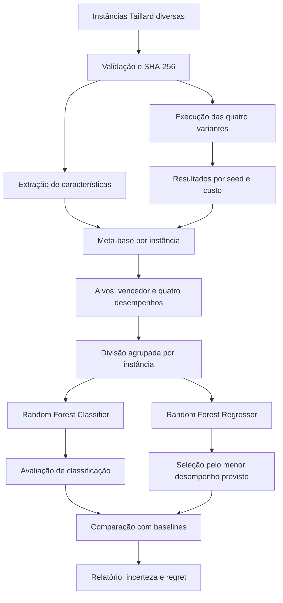

# Plano de Meta-Learning: classificação e regressão

**Status:** planejamento metodológico aprovado para implementação futura. **Nenhum experimento de Meta-Learning foi executado por este documento.**

Este plano define um pipeline único para comparar duas estratégias de Meta-Learning — classificação e regressão — usando a mesma base experimental. É uma extensão opcional do projeto, não uma etapa obrigatória do roteiro do professor e não substitui as Semanas 1–6.

## 1. Objetivo

Dada uma instância PFSP/Taillard ainda não vista, selecionar automaticamente uma das quatro estratégias GWO avaliadas na Semana 6:

- `baseline`;
- `optuna`;
- `surrogate`;
- `fuzzy`.

A camada meta aprende a escolher a estratégia. Ela **não** substitui o avaliador de makespan, não prevê diretamente permutações e não altera os algoritmos-base.

O escopo inicial é o PFSP clássico de uma fábrica, minimizando makespan. Não misturar com PFS/tardiness histórico, DPFSP-DD ou com a proposta original dengue/LSTM.

## 2. Decisão arquitetural: uma base, dois modelos

O pipeline terá duas fases separadas:

1. **Construção da meta-base:** extrair características de cada instância e obter os resultados das quatro variantes sob protocolo controlado.
2. **Treinamento e avaliação:** derivar alvos de classificação e regressão da mesma meta-base e treinar os dois modelos em paralelo.

Assim, cada instância é executada uma única vez por combinação variante × seed. Classificação e regressão não provocam uma segunda bateria GWO.

### 2.1 Classificação

Uma linha por instância. O alvo é a variante com menor desempenho médio normalizado, considerando as seeds daquela instância.

Modelo inicial: `RandomForestClassifier`.

Saídas:
- classe prevista;
- probabilidades por variante;
- confiança/margem entre as duas maiores probabilidades.

A classe-alvo será derivada dos resultados agregados por instância, nunca de uma execução individual. Registrar margem entre a melhor e a segunda melhor variante. Instâncias com diferenças muito pequenas serão sinalizadas como rótulos de baixa confiança para análise de sensibilidade; não ocultar empates ou instabilidade.

### 2.2 Regressão

A mesma linha de características terá quatro alvos numéricos: desempenho médio normalizado de Baseline, Optuna, Surrogate e Fuzzy.

Modelo inicial: `RandomForestRegressor` multioutput ou quatro regressors independentes, escolhendo uma única opção após teste técnico. A decisão é a variante com menor desempenho previsto.

Saídas:
- quatro valores previstos;
- variante selecionada;
- erro de previsão por variante;
- regret da seleção: desempenho observado da variante escolhida menos o melhor desempenho observado naquela instância.

A regressão permite analisar não apenas se o modelo acertou a classe vencedora, mas também o custo de escolher uma alternativa quase tão boa ou muito pior.

## 3. Meta-base e unidade estatística

A unidade independente de generalização é a **instância**, não a execução nem a seed.

Estrutura lógica:

- uma linha por instância;
- características calculadas apenas a partir da matriz de tempos de processamento;
- quatro alvos de desempenho agregados, um por variante;
- resultados individuais por seed mantidos em arquivo separado para auditoria e estimativa de variabilidade.

As seeds reduzem ruído na estimativa de desempenho de cada variante, mas **não aumentam o número de instâncias independentes**. Não dividir linhas de execuções/seed aleatoriamente entre treino e teste: isso causaria vazamento da mesma instância.

### 3.1 Instâncias atuais e expansão necessária

O benchmark atual usa `ta001` (20 jobs × 5 máquinas) e `ta011` (20 jobs × 10 máquinas). Duas instâncias — ambas com 20 jobs — não permitem treinar nem avaliar de forma confiável um meta-modelo.

É necessário ampliar o conjunto com instâncias Taillard de diferentes tamanhos e relações jobs/máquinas. A seleção deve ser estratificada por dimensão e cobrir diferentes regimes, não apenas muitas instâncias quase idênticas.

Plano em fases, sujeito a medição de custo:

- **Piloto de viabilidade:** 12–20 instâncias diversas, poucas seeds (por exemplo, 3–5), apenas para validar extração, execução, persistência e custo. Não usar o piloto como evidência final de generalização.
- **Meta-base exploratória:** alvo inicial de 30–50 instâncias, com 10 seeds por variante/instância, se o custo permitir. Esse tamanho ainda pode ser insuficiente para conclusões fortes; tratar resultados como exploratórios.
- **Expansão confirmatória:** buscar 50–100 ou mais instâncias, com 20–30 seeds por variante/instância, se os recursos e o tempo permitirem. A suficiência deve ser julgada pela diversidade e pela incerteza, não apenas pela contagem.

Os números são metas de planejamento, não garantia de poder estatístico. Antes de expandir, medir tempo por instância/variante no piloto. Priorizar cobertura de dimensões e integridade dos dados.

Os resultados publicados de Semana 6 para `ta001` e `ta011` podem ser incorporados como observações históricas compatíveis, após validação de hashes, protocolo, variantes e seeds. Não duplicar essas linhas executando-as novamente sem necessidade. Registrar a proveniência de cada linha e manter o conjunto original imutável.

## 4. Características das instâncias

O extrator deve ser determinístico, independente das variantes e calculado somente da matriz de processamento (P\).

Características candidatas:

- dimensões: número de jobs, número de máquinas e razão jobs/máquinas;
- estatísticas globais dos tempos: média, desvio padrão, coeficiente de variação, mínimo, máximo e quantis;
- carga por máquina: soma, média, desvio e coeficiente de variação entre máquinas;
- carga por job: soma, média, desvio e coeficiente de variação entre jobs;
- estrutura: máquina de maior carga, proporção da carga da máquina mais carregada e correlações entre cargas de máquinas adjacentes;
- dispersão relativa de processamento por máquina e por job.

Regras:
- não usar makespan, upper bound, lower bound, resultados GWO, seeds, nome do arquivo ou identificadores como preditores;
- UB/LB podem ser usados para normalização e auditoria do alvo, mas não como feature, para evitar que o modelo dependa de informação de benchmark que pode não existir em uma instância nova;
- tratar valores ausentes e colunas constantes explicitamente;
- fixar nomes, unidades e versão do extrator;
- testar invariância do extrator a mudanças de caminho/nome do arquivo;
- calcular qualquer padronização/seleção de features dentro do fold de treino, nunca sobre o dataset completo.

## 5. Alvos e normalização

O objetivo primário permanece qualidade da solução. Para cada instância (i), variante (v) e seed (s), armazenar o makespan final (C_{i,v,s}), runtime e contadores.

Alvo primário por variante:

[
y_{i,v}=\frac{\operatorname{mean}_{s}(C_{i,v,s})}{UB_i}
]

quando um upper bound publicado confiável estiver disponível e validado. Para instâncias sem UB, usar uma normalização alternativa definida antes da execução (por exemplo, dividir pela melhor média observada entre variantes da própria instância) apenas para análise relativa; documentar que essa normalização é relativa e não comparável entre instâncias. Não misturar silenciosamente as duas convenções.

A classificação seleciona o menor (y_{i,v}). A regressão prevê os quatro (y_{i,v}) e seleciona o menor. Runtime e número de avaliações são métricas secundárias e não entram no alvo primário inicial; uma futura seleção multiobjetivo exigiria outro protocolo explícito.

Também armazenar mediana, desvio padrão, intervalo de confiança/bootstrapping por seed, mínimo, máximo e taxa de alcance do UB, sem reduzir a base a uma única média.

## 6. Protocolo de execução da meta-base

Para cada instância nova:

1. validar e calcular SHA-256 do arquivo;
2. extrair e persistir as features;
3. executar as quatro variantes com configurações congeladas da Semana 6;
4. usar o mesmo conjunto de seeds por variante dentro da instância;
5. armazenar makespan, runtime, avaliações exatas, previsões surrogate, tempo de inferência e demais contadores;
6. verificar combinações ausentes/duplicadas e consistência dos contadores;
7. agregar resultados e derivar os alvos somente após a validação.

As configurações congeladas devem corresponder ao protocolo auditado da Semana 6. O orçamento exato do Surrogate é diferente (1.530 avaliações exatas + 15.000 previsões por execução, contra 15.030 avaliações exatas nas demais variantes). Reportar essa diferença e os custos de preparação separadamente; não declarar igualdade de orçamento.

O custo de gerar a meta-base pode ser elevado: o piloto deve estimar o custo antes da expansão. Não iniciar a bateria grande automaticamente no notebook.

## 7. Divisão treino/validação/teste sem vazamento

Todas as divisões são feitas por **instância**.

Protocolo preferido:
- reservar um holdout final de instâncias nunca usadas para decisões de features/modelo;
- no conjunto de desenvolvimento, usar validação cruzada agrupada por instância (por exemplo, `GroupKFold` ou `LeaveOneGroupOut`, com cada instância como grupo);
- se houver famílias/dimensões muito relacionadas, agrupar por bloco de instâncias ou família para testar generalização mais difícil;
- executar seleção de hiperparâmetros somente dentro dos folds de desenvolvimento;
- abrir o holdout uma única vez após congelar o pipeline.

Com poucas instâncias, um holdout fixo pode ficar instável. Nesse caso, reportar validação cruzada agrupada como exploratória e não alegar teste independente robusto. Nunca usar seeds de uma mesma instância em treino e teste como se fossem instâncias diferentes.

## 8. Baselines obrigatórios

Comparar cada meta-modelo com seletores simples:

1. seleção aleatória uniforme entre as quatro variantes;
2. sempre Baseline;
3. sempre Optuna;
4. sempre Surrogate;
5. sempre Fuzzy;
6. melhor variante global escolhida apenas no conjunto de treino;
7. classificador;
8. regressor com seleção pelo menor valor previsto.

O baseline “melhor global” deve ser recalculado dentro de cada fold usando somente o treino. Não selecionar a melhor variante usando os rótulos do teste.

## 9. Métricas de avaliação

**Classificação**
- acurácia e balanced accuracy;
- macro-F1;
- matriz de confusão;
- precisão/recall por variante;
- log loss e Brier score, se probabilidades forem usadas;
- acurácia com análise separada de rótulos de baixa confiança.

**Regressão**
- MAE e RMSE por variante;
- (R^2) por alvo, com cautela em amostras pequenas;
- erro de ranking entre variantes;
- regret médio/mediano da variante selecionada;
- frequência em que a seleção regressiva escolhe a melhor ou uma variante estatisticamente/operacionalmente equivalente.

**Seleção final**
- makespan normalizado observado da estratégia selecionada no teste;
- diferença para a melhor variante-oráculo observada no teste (regret);
- comparação pareada por instância contra os baselines;
- runtime/custo da estratégia escolhida e custo adicional do meta-modelo.

A variante-oráculo do teste é apenas referência retrospectiva; não é um método disponível em produção.

## 10. Análise de incerteza e rótulos instáveis

A melhor variante por média pode mudar com as seeds. Portanto:
- preservar resultados por seed;
- estimar incerteza da diferença entre as duas melhores variantes;
- marcar rótulos com pequena margem como baixa confiança;
- repetir análise excluindo ou ponderando esses casos como sensibilidade, sem removê-los silenciosamente;
- não afirmar que a classe prevista é universal quando as diferenças observadas são praticamente equivalentes.

## 11. Estrutura de diretórios proposta

A implementação futura deve ficar isolada, sem alterar scripts/artefatos das Semanas 2–6:

```text
experiments/meta_learning/
├── README.md
├── config/
│   └── meta_learning_v1.json
├── data/
│   ├── instance_features.csv
│   ├── run_results.csv
│   └── meta_dataset.csv
├── scripts/
│   ├── extract_instance_features.py
│   ├── build_meta_dataset.py
│   ├── train_classifier.py
│   ├── train_regressor.py
│   ├── evaluate_meta_models.py
│   └── run_meta_learning.py
├── models/
├── reports/
├── tests/
└── results/
    └── meta_learning_v1/
```

Os arquivos de dados/modelos/resultados só serão criados durante a implementação/execução. Não versionar artefatos vazios nem colocar resultados fictícios no repositório. Configurações, scripts, testes e relatórios devem ser versionados. Cada execução deve registrar commit, hashes das instâncias, versão do extrator, parâmetros, seeds, ambiente e timestamp.

## 12. Pipeline operacional



## 13. Critérios de aceite antes de qualquer conclusão

- [ ] Conjunto de instâncias ampliado e diversidade documentada.
- [ ] Piloto de custo concluído antes de definir a bateria final.
- [ ] Features independentes dos resultados e sem vazamento.
- [ ] Resultados das quatro variantes íntegros, com seeds e contadores auditáveis.
- [ ] Meta-base com uma linha por instância e proveniência rastreável.
- [ ] Divisões exclusivamente por instância.
- [ ] Baselines simples calculados sem consultar o teste.
- [ ] Classificação e regressão avaliadas sobre os mesmos folds/holdout.
- [ ] Regret, incerteza dos rótulos e custos reportados.
- [ ] Testes automatizados, relatório e reprodução documentados.

## 14. Limitações e decisão de escopo

- As duas instâncias atuais não sustentam treinamento/avaliação de Meta-Learning.
- A meta-base exige novas execuções e pode custar milhares de runs; não executar sem piloto e estimativa de recursos.
- Random Forest é um ponto de partida, não uma escolha comprovadamente ótima.
- O resultado será válido para a distribuição de instâncias representada no dataset; generalização para outras famílias de scheduling não está garantida.
- Meta-Learning é uma extensão independente e opcional. A entrega principal continua sendo a linha PFSP/Taillard e os resultados auditados das Semanas 2–6.
- O documento define o plano, não afirma que código, modelos ou experimentos de Meta-Learning já existem.
